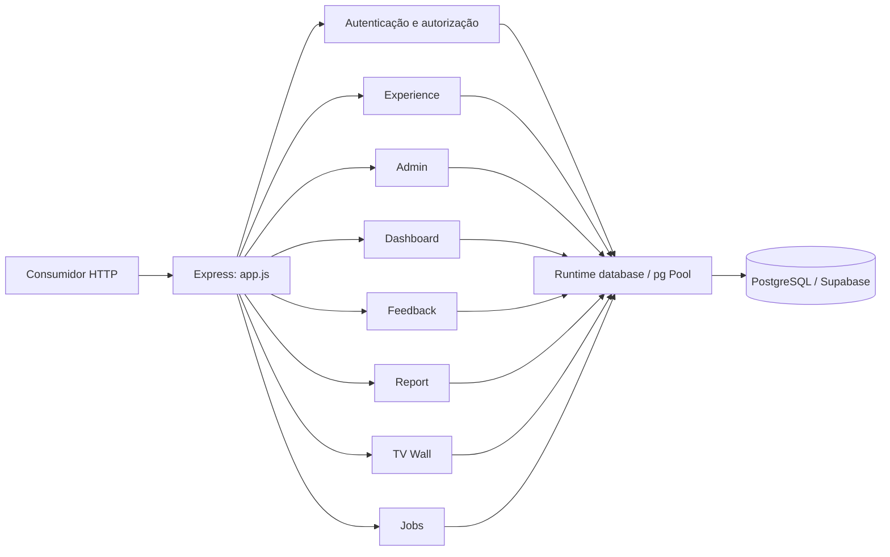

# Arquitetura do back-end

## Visão geral

Aplicação monolítica modular em Node.js 20/Express. O processo HTTP monta os
módulos em `src/app.js`; os módulos contêm rotas, validação, autorização e
operações de domínio. O banco principal é PostgreSQL, acessado por `pg`.
Quando não há configuração de banco, os módulos usam `src/core/memory.js` para
desenvolvimento/testes; uma conexão configurada que falha não muda
automaticamente para memória.

## Componentes e responsabilidades

| Componente | Responsabilidade |
|---|---|
| `src/app.js` | Middleware HTTP, montagem dos routers, `/health`, `/docs` e tratamento centralizado de erros. |
| `src/modules/auth` | Login, JWT, recarga do usuário do banco e middleware de permissão. |
| `src/modules/experience` | Setores, fluxo de perguntas, pesquisas, respostas, pacientes e manifestações públicas. |
| `src/modules/admin` | Gerenciamento de setores, perguntas, equipes, perfis e contas. |
| `src/modules/dashboard` | Agregações e filtros por setor/data/turno. |
| `src/modules/feedback` | Caixa da Ouvidoria e atualização de manifestações. |
| `src/modules/report` | Exportação Excel e resposta 501 para PDF indisponível. |
| `src/modules/tvwall` | Métricas agregadas e supressão de pequenos grupos. |
| `src/modules/jobs` | Indicadores de abandono e retenção. |
| `src/runtime/database.js` | Pool PostgreSQL, `query`, transações e wrapper de handlers assíncronos. |
| `src/core/errors.js` | Erros de aplicação e payload HTTP padronizado. |
| `src/core/memory.js` | Dados iniciais em memória para modo sem banco. |
| `database/` | DDL, migrações e dados de referência. |

`src/config/*` reexporta a configuração/runtime legado. Não existe camada de
classes Repository/DAO: os módulos de domínio chamam a função `query` com SQL
parametrizado. A criação/atualização de conta e associação de setores usa
transação.

## Fluxo de uma requisição protegida

1. Express aplica Helmet, CORS, parser JSON com limite e rate limiting.
2. O router valida dados de entrada com Zod quando aplicável.
3. `requireAuth` verifica o JWT e recarrega usuário/permissões do armazenamento.
4. O middleware de perfil e a lógica de escopo validam a autorização.
5. O módulo chama PostgreSQL com parâmetros ou o store de memória.
6. Erros são convertidos em respostas JSON pelo handler central.

## Padrões e atributos de qualidade

- **Módulos por domínio:** reduz acoplamento entre rotas distintas.
- **Middleware de autorização:** centraliza autenticação e permissões; regras de
  setor continuam verificadas no módulo que conhece a operação.
- **SQL parametrizado:** evita concatenar dados do cliente em comandos SQL.
- **Validação de entrada:** Zod nas operações de escrita e filtros.
- **Persistência relacional:** constraints e transações protegem integridade.
- **Observabilidade mínima:** `/health`, erros padronizados e logs dos scripts;
  métricas operacionais distribuídas/tracing não estão configurados.
- **Escalabilidade:** o Pool permite múltiplas conexões e o serviço pode ser
  hospedado em Render/PostgreSQL gerenciado; cache, filas e limites de pool sob
  carga precisam de dimensionamento operacional.

## Implantação documentada

O README descreve Render para API e Supabase PostgreSQL/Session Pooler. Isso é
documentação de configuração, não evidência de disponibilidade do ambiente
online. URL de produção, plano, backups e alertas devem ser confirmados no painel
do provedor antes do aceite.
