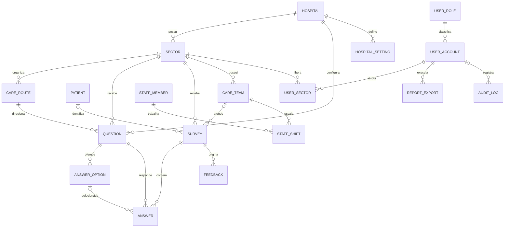
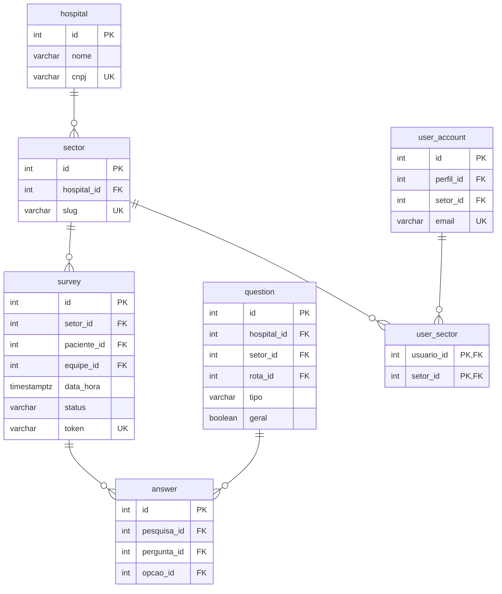

# Modelo de dados e requisitos

## Paradigma

O esquema é PostgreSQL relacional. A escolha é adequada ao modelo observado:
pesquisas ligam setores, respostas ligam perguntas e pesquisas, manifestações
dependem de pesquisas, e contas têm perfis e associações de setor. Chaves
estrangeiras, `UNIQUE`, `CHECK`, transações e agregações SQL garantem integridade
e suportam os relatórios do domínio.

Um banco NoSQL poderia armazenar eventos/documentos, mas duplicaria dados de
pergunta/setor e exigiria regras adicionais para manter consistência entre
respostas, relatórios e acesso por setor. Não há requisito atual de ingestão em
volume que justifique essa complexidade. Essa justificativa se baseia no modelo
existente; não substitui uma validação de requisitos de cliente.

## Entidades e atributos

Tipos abaixo refletem `database/schema.sql`. Todas as entidades com `id` usam
`SERIAL` como PK salvo indicação.

| Entidade | Atributos principais | Chaves/regras |
|---|---|---|
| `hospital` | `nome VARCHAR(255)`, `cnpj VARCHAR(18)`, `endereco TEXT`, `criado_em TIMESTAMPTZ` | PK `id`; `cnpj UNIQUE NOT NULL`. |
| `sector` | `hospital_id INTEGER`, `nome VARCHAR(150)`, `slug VARCHAR(150)`, `url VARCHAR(255)`, `qrcode TEXT`, `ativo BOOLEAN` | FK hospital; slug único. |
| `care_route` | `setor_id`, `caminho VARCHAR(255)`, `ordem INTEGER`, `ativo BOOLEAN` | FK setor. |
| `question` | `hospital_id`, `setor_id NULL`, `rota_id NULL`, `texto TEXT`, `tipo VARCHAR(20)`, `geral`, `ordem`, `obrigatoria`, `ativo` | FK hospital/setor/rota; `CHECK` do fluxo geral/setorial; índice único parcial para uma pergunta geral ativa por hospital. |
| `answer_option` | `pergunta_id`, `valor SMALLINT`, `rotulo VARCHAR(120)`, `emoji VARCHAR(20)` | FK pergunta; valor 1–5; unicidade pergunta/valor. |
| `patient` | `nome`, `nome_mae`, `data_nascimento DATE`, `telefone VARCHAR(30)`, `consentimento BOOLEAN`, `criado_em` | Campos pessoais opcionais; telefone com validação de tamanho. |
| `survey` | `setor_id`, `paciente_id NULL`, `equipe_id NULL`, `data_hora TIMESTAMPTZ`, `turno`, `anonimo`, `consentimento`, `media_parcial DECIMAL(3,1)`, `nps_nota SMALLINT`, `status`, `encaminhado_ouvidoria`, `ultima_atividade`, `token` | FKs setor/paciente/equipe; token único; checks de NPS/turno/status. |
| `answer` | `pesquisa_id`, `pergunta_id`, `opcao_id NULL`, `valor SMALLINT NULL`, `texto TEXT NULL` | FKs; unicidade pesquisa/pergunta; ao menos um conteúdo não vazio. |
| `feedback` | `pesquisa_id`, `tipo`, `descricao`, `status`, `data TIMESTAMPTZ`, `anonimo`, `origem`, `media_origem`, `motivo_encaminhamento`, `canal_contato`, `parecer_interno` | FK pesquisa; checks de tipo/status/origem. |
| `care_team` | `setor_id`, `nome`, `turno`, `data DATE` | FK setor; índice único setor/data/turno. |
| `staff_member` | `nome`, `cargo`, `registro` | Profissionais associados a escalas. |
| `staff_shift` | `equipe_id`, `profissional_id`, `data`, `turno` | FKs equipe/profissional; índice único de escala. |
| `user_role` | `nome`, `permissoes JSONB` | Perfis e lista de permissões. |
| `user_account` | `nome`, `email`, `perfil_id`, `setor_id NULL`, `ativo`, `senha_hash` | Email único; FK perfil; `setor_id` é compatibilidade/primeiro setor. |
| `user_sector` | `usuario_id`, `setor_id` | PK composta; FKs com `ON DELETE CASCADE`; relação N:N usuário-setor. |
| `audit_log` | `usuario_id NULL`, `acao`, `entidade`, `entidade_id`, `data`, `ip` | FK de usuário opcional. |
| `report_export` | `usuario_id`, `tipo`, `data`, `filtros JSONB` | FK usuário; tipo Excel/PDF. |
| `hospital_setting` | `hospital_id`, `chave`, `valor JSONB` | PK composta hospital/chave. |

`vw_nps_by_sector_shift` é uma view agregada, não uma tabela física.

## Diagrama conceitual

## Diagrama lógico resumido

## Integridade, privacidade e scripts

- `ON DELETE CASCADE` é usado em dados dependentes de hospital/setor/pergunta;
  paciente/equipe/opção podem usar `SET NULL` em referências opcionais.
- Checks e índices estão definidos em `database/schema.sql`; migrações
  incrementais ficam em `database/migrations/`; dados de referência em
  `database/seed.sql`.
- O seed de hospital/setores/perfis é idempotente por chave. Não contém
  credenciais administrativas; o usuário inicial exige variáveis `SEED_ADMIN_*`.
- Dados pessoais devem ser mínimos, com consentimento e retenção definidos pela
  política aprovada pelo hospital.
